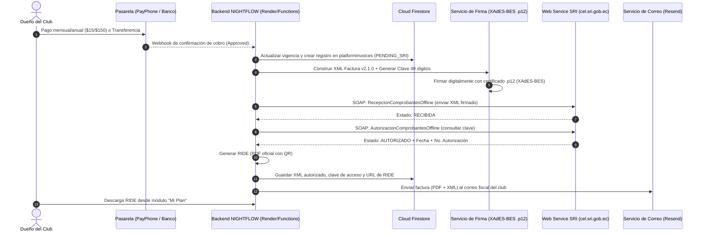

# NIGHTFLOW VIP — Plan Maestro de Facturación Electrónica SRI (Ecuador)
## Automatización de Cobros y Emisión de Facturas para Suscripciones SaaS (Flujo B)

> **Estado del Documento:** Planificación y Especificación Arquitectónica (Pendiente de ejecución).  
> **Fecha de Elaboración:** Octubre 2026.  
> **Ámbito de Aplicación:** Emisión automática de comprobantes electrónicos autorizados por el Servicio de Rentas Internas (SRI) del Ecuador cuando un establecimiento nocturno abona su suscripción mensual o anual (`starter`, `club_pro`, `black_vip`).

---

## 1. Resumen Ejecutivo y Arquitectura del Sistema

En NIGHTFLOW VIP existen dos flujos monetarios estrictamente aislados:
* **Flujo A (Operativo del Club):** Clientes finales pagan consumos y reservas al club mediante el PSP del establecimiento (Kushki / Deuna del dueño). NIGHTFLOW **no intermedia ni factura** estos fondos.
* **Flujo B (SaaS Plataforma):** El dueño del club abona la tarifa de software mensual o anual a **NIGHTFLOW VIP S.A.S.**. Este es el flujo que se factura con el SRI mediante este plan.



---

## 2. Requisitos Previos Administrativos y Legales (Ecuador)

Antes de iniciar la codificación, NIGHTFLOW VIP S.A.S. debe contar con los siguientes activos vigentes:

| Requisito | Detalle / Proveedor | Propósito |
|---|---|---|
| **RUC Activo** | RUC de persona jurídica (ej: `0993345892001`) o natural en el SRI | Emisor legal de las facturas con actividad económica de desarrollo de software / SaaS. |
| **Firma Electrónica (.p12)** | Archivo en formato PKCS#12 emitido por entidad autorizada (Security Data, BCE, Consejo Judicatura, ANF, Uanataca) | Firma digital criptográfica obligatoria para validar la autenticidad del XML. |
| **Clave del Archivo .p12** | Contraseña del certificado digital | Desencriptar la clave privada durante el proceso de firmado. |
| **Ambiente de Pruebas SRI** | Solicitud de autorización en `sri.gob.ec` en ambiente de Certificación/Pruebas | Permite timbrar comprobantes sin validez tributaria para testeo. |
| **Ambiente de Producción SRI** | Solicitud de pase a producción en `sri.gob.ec` | Timbrado tributario con validez legal ante el Estado. |
| **Punto de Emisión y Secuencial** | Establecimiento `001`, Punto de emisión `001`, Secuencial desde `000000001` | Numeración correlativa obligatoria. |

---

## 3. Especificación Técnica del SRI (Ecuador)

### 3.1 Clave de Acceso (49 dígitos numéricos)
Cada factura electrónica exige una clave de acceso única e irrepetible generada con la siguiente estructura:

```text
[Fecha ddmmaaaa (8)] + [Tipo Comprobante (2: 01)] + [RUC Emisor (13)] + [Ambiente (1: 1 pruebas, 2 prod)] 
+ [Serie Establecimiento-PtoEmisión (6: 001001)] + [Secuencial (9)] + [Código Numérico (8)] + [Tipo Emisión (1: 1 normal)] 
+ [Dígito Verificador Módulo 11 (1)]
```

#### Algoritmo Módulo 11 (Cálculo del Dígito Verificador):
1. Se toman los 48 dígitos iniciales de derecha a izquierda.
2. Se multiplican por los factores cíclicos ponderados: `2, 3, 4, 5, 6, 7, 2, 3, 4...`.
3. Se calcula la suma total.
4. Se calcula el residuo: `residuo = suma % 11`.
5. `digitoVerificador = 11 - residuo`.
   - Si `digitoVerificador == 11`, el dígito es `0`.
   - Si `digitoVerificador == 10`, el dígito es `1`.

### 3.2 Estructura del XML de Factura (Esquema XSD v1.1.0 / v2.1.0)
El documento XML debe cumplir rigurosamente con los campos:
* `<infoTributaria>`:
  * `ambiente`: `1` (Pruebas) o `2` (Producción).
  * `tipoEmision`: `1` (Normal).
  * `razonSocial`: `NIGHTFLOW VIP S.A.S.`.
  * `nombreComercial`: `NIGHTFLOW VIP`.
  * `ruc`: `0993345892001`.
  * `claveAcceso`: (49 dígitos calculados).
  * `codDoc`: `01` (Factura).
  * `estab`: `001`.
  * `ptoEmi`: `001`.
  * `secuencial`: `000000001` (9 dígitos numéricos con ceros a la izquierda).
  * `dirMatriz`: Dirección legal en Ecuador.
* `<infoFactura>`:
  * `fechaEmision`: Formato `dd/mm/aaaa`.
  * `dirEstablecimiento`: Dirección local.
  * `obligadoContabilidad`: `SI` o `NO`.
  * `tipoIdentificacionComprador`: `04` (RUC) o `05` (Cédula) o `06` (Pasaporte).
  * `razonSocialComprador`: Nombre o razón social del club.
  * `identificacionComprador`: RUC o Cédula del club cliente.
  * `totalSinImpuestos`: Subtotal sin IVA (ej: `13.04` para un plan de $15).
  * `totalDescuento`: `0.00`.
  * `<totalConImpuestos>`:
    * `codigo`: `2` (IVA).
    * `codigoPorcentaje`: `4` (IVA 15% vigente en Ecuador).
    * `baseImponible`: Monto gravado.
    * `valor`: Monto del IVA (ej: `1.96`).
  * `importeTotal`: Monto final pagado (ej: `15.00` o `150.00`).
  * `moneda`: `DOLAR`.
  * `<pagos>`:
    * `formaPago`: `20` (Otros con utilización del sistema financiero) o `19` (Tarjeta de crédito/débito).
    * `total`: Monto total.
* `<detalles>`:
  * `<detalle>`:
    * `codigoPrincipal`: `SAAS-PRO-MONTHLY` (o anual).
    * `descripcion`: `Suscripción Mensual Plataforma NIGHTFLOW VIP - Módulo Discoteca y Puerta`.
    * `cantidad`: `1.00`.
    * `precioUnitario`: Subtotal.
    * `descuento`: `0.00`.
    * `precioTotalSinImpuesto`: Subtotal.
    * `<impuestos>`: Desglose IVA 15%.
* `<infoAdicional>`:
  * Campos como `Email`, `Telefono`, `Periodo`, `ClubId`.

### 3.3 Firma Digital XAdES-BES
El XML generado debe ser firmado electrónicamente de acuerdo con el estándar **XAdES-BES (XML Advanced Electronic Signatures)**:
* Algoritmo de resumen: SHA-1 o SHA-256 (el SRI soporta SHA-1 y SHA-256 en XAdES-BES).
* Certificado X.509 incrustado en el bloque `<ds:KeyInfo>`.
* La firma sella el nodo `<factura id="comprobante" version="2.1.0">`.

---

## 4. Endpoints Oficiales de Web Services SOAP del SRI

El SRI utiliza dos servicios web SOAP independientes:

| Servicio | Ambiente de Pruebas (Celcer) | Ambiente de Producción (Cel) |
|---|---|---|
| **Recepción de Comprobantes** | `https://celcer.sri.gob.ec/comprobantes-electronicos-ws/RecepcionComprobantesOffline?wsdl` | `https://cel.sri.gob.ec/comprobantes-electronicos-ws/RecepcionComprobantesOffline?wsdl` |
| **Autorización de Comprobantes** | `https://celcer.sri.gob.ec/comprobantes-electronicos-ws/AutorizacionComprobantesOffline?wsdl` | `https://cel.sri.gob.ec/comprobantes-electronicos-ws/AutorizacionComprobantesOffline?wsdl` |

### Protocolo de Comunicación:
1. **Paso 1 (Envío):**
   - El XML firmado se codifica en **Base64**.
   - Se invoca el método `validarComprobante` enviando el parámetro `xml` en Base64.
   - Si la respuesta es `ESTADO = RECIBIDA`, el SRI acepta el archivo para su cola de procesamiento.
   - Si la respuesta es `DEVUELTA`, el SRI devuelve la lista de errores sintácticos (firma inválida, RUC no autorizado, formato incorrecto).
2. **Paso 2 (Consulta de Autorización):**
   - Se espera entre 3 y 8 segundos (tiempo de procesamiento de cola del SRI).
   - Se invoca el método `autorizacionComprobante` enviando la `claveAcceso` (49 dígitos).
   - Respuestas posibles:
     - `AUTORIZADO`: Retorna `numeroAutorizacion` (coincide con la clave de acceso) y `fechaAutorizacion`.
     - `EN PROCESO`: Aún en procesamiento; reintentar en 5 segundos.
     - `NO AUTORIZADO`: Retorna mensaje de rechazo tributario.

---

## 5. Diseño de Base de Datos y Modelo en Firestore

Se implementará una colección raíz dedicada para comprobantes fiscales de la plataforma:

### Colección `platformInvoices/{invoiceId}`
```typescript
interface PlatformInvoiceDocument {
  id: string; // ej: "INV-2026-000001"
  businessId: string; // ID del club cliente (ej: "club_barahunda")
  clubName: string; // "Barahunda VIP"
  
  // Datos del Comprobante
  establishment: "001";
  emissionPoint: "001";
  sequential: "000000042";
  accessKey: string; // 49 dígitos
  environment: "sandbox" | "production";
  
  // Fechas
  issuedAt: number; // Timestamp emisión
  authorizedAt?: number; // Timestamp autorización SRI
  
  // Estado Tributario SRI
  status: "DRAFT" | "SIGNED" | "SENT" | "AUTHORIZED" | "REJECTED" | "CONTINGENCY";
  sriMessages?: Array<{
    identificador: string;
    mensaje: string;
    informacionAdicional?: string;
    tipo: "ERROR" | "ADVERTENCIA";
  }>;
  
  // Valores Económicos (USD)
  planId: "starter" | "club_pro" | "black_vip";
  cycle: "monthly" | "annual";
  subtotal: number; // ej: 13.04
  ivaRate: 0.15; // 15%
  ivaAmount: number; // ej: 1.96
  totalAmount: number; // ej: 15.00
  
  // Datos Fiscales del Receptor
  buyer: {
    identificationType: "04" | "05" | "06"; // RUC, Cédula, Pasaporte
    identification: string; // ej: "1792345678001"
    legalName: string; // "OPERADORA NOCTURNA S.A."
    email: string;
    phone?: string;
    address?: string;
  };

  // Referencia al cobro
  paymentOrigin: "PAYPHONE" | "BANK_TRANSFER" | "MANUAL_OVERRIDE";
  paymentReference: string; // ID transacción PayPhone o ref bancaria
  
  // Archivos generados
  xmlUrl?: string; // URL en Firebase Storage
  ridePdfUrl?: string; // URL del PDF en Firebase Storage
}
```

---

## 6. Generación del RIDE (Representación Impresa en PDF)

El SRI exige que el RIDE contenga obligatoriamente:
1. Logotipo de NIGHTFLOW VIP y datos de la empresa matriz.
2. Clave de acceso con su respectivo **Código de Barras (Code128)** o Código QR.
3. Número de autorización y fecha y hora de autorización devueltas por el SRI.
4. Tipo de ambiente (PRUEBAS / PRODUCCIÓN) y tipo de emisión (NORMAL).
5. Cuadro de datos del cliente (Razón social, RUC, Fecha, Guía de remisión si aplica).
6. Tabla de productos/servicios con precios unitarios y subtotales.
7. Información adicional (correo para recepción de notificaciones).
8. Formas de pago utilizadas.

**Librería recomendada:** `pdfmake` o plantilla HTML renderizada a PDF mediante microservicio ligero en el backend.

---

## 7. Manejo de Contingencias y Resiliencia (Disponibilidad SRI)

Los servicios web del SRI sufren intermitencias y mantenimientos frecuentes (especialmente en horas pico):

1. **Cola de Reintentos Idempotente:**
   - Si el SRI no responde o arroja error `503`, el backend marca la factura como `PENDING_RETRY` y programa un reintento a los 1, 5 y 15 minutos mediante el ticker del servidor.
2. **Sin Afectación al Club:**
   - La suscripción del club se renueva **inmediatamente** al confirmar el pago bancario o de PayPhone. La latencia del SRI **nunca debe bloquear** el acceso del club a su sistema de puerta ni a la sala en vivo.
3. **Alerta a SuperAdmin:**
   - Si tras 5 intentos el SRI rechaza el comprobante (ej: error en RUC del cliente), se envía una notificación al panel SuperAdmin para corrección de datos y reenvío manual.

---

## 8. Hoja de Ruta de Implementación (Fases de Ejecución Futura)

Cuando se decida activar esta funcionalidad, el desarrollo se dividirá en 6 fases ordenadas:

### Fase 1: Entorno Criptográfico y Secretos (Backend)
- [ ] Guardar el archivo `.p12` de la firma electrónica como secreto seguro (variable Base64 en Render / Secret Manager `SRI_P12_BASE64` y `SRI_P12_PASSWORD`).
- [ ] Implementar la clase utilitaria `EcuadorSriKeyGenerator` (cálculo de 49 dígitos y Módulo 11).
- [ ] Implementar el módulo de firmado digital XAdES-BES en Node.js (`functions/src/sri/signer.ts`).

### Fase 2: Constructor del XML Tributario
- [ ] Crear el generador de XML de Factura v2.1.0 (`functions/src/sri/invoiceXmlBuilder.ts`) con el catálogo de impuestos del SRI (Código 2, Porcentaje 4 = IVA 15%).
- [ ] Validar el esquema XML contra el archivo XSD oficial del SRI.

### Fase 3: Cliente SOAP del SRI
- [ ] Implementar cliente SOAP para `RecepcionComprobantesOffline` y `AutorizacionComprobantesOffline` (`functions/src/sri/sriClient.ts`).
- [ ] Agregar soporte de cambio automático entre ambiente de Pruebas (`celcer.sri.gob.ec`) y Producción (`cel.sri.gob.ec`).

### Fase 4: Generador del RIDE (PDF) y Almacenamiento
- [ ] Diseñar el formato PDF profesional del RIDE con código de barras Code128 y QR.
- [ ] Guardar XML y PDF autorizados en Firebase Storage bajo `platformInvoices/{year}/{month}/{invoiceId}.pdf`.

### Fase 5: Conexión con Eventos de Cobro
- [ ] Al recibir webhook de PayPhone `Approved` -> disparar `issueSriInvoiceForSubscription()`.
- [ ] Al aprobar una transferencia bancaria en `SuperAdminSubscriptionsView` -> opción de "Generar Factura SRI Inmediata".
- [ ] Envío automático del correo con los 2 adjuntos (RIDE + XML) al cliente.

### Fase 6: Pruebas en Sandbox del SRI y Pase a Producción
- [ ] Emitir 5 facturas de prueba en el ambiente `celcer.sri.gob.ec`.
- [ ] Validar recepción en el portal de pruebas del SRI.
- [ ] Cambiar variable de entorno a Producción (`cel.sri.gob.ec`) y realizar emisión real de $0.01 o primera mensualidad.

---

## 9. Comparativa: Integración Directa vs. API Intermediaria (Dátil / Facturama)

Si se desea reducir el tiempo de desarrollo inicial de semanas a días:

| Criterio | Opción A: Web Service Directo SRI | Opción B: API Ecuatoriana (ej. Dátil) |
|---|---|---|
| **Costo por factura** | **$0.00** de por vida | ~$0.05 a $0.15 por factura o plan de $15/mes |
| **Complejidad de código** | Alta (Firma XAdES-BES, SOAP XML, reintentos) | Baja (Envío de un JSON simple vía REST API) |
| **Mantenimiento** | Tú mantienes los cambios de esquema del SRI | La API se encarga de actualizaciones del SRI |
| **Velocidad de salida** | 2 a 3 semanas de desarrollo y pruebas | 2 a 3 días de integración |

> **Recomendación para NIGHTFLOW:** Iniciar con la **Opción B (Dátil / Facturama)** si se desea facturación automática inmediata con poco código, o ejecutar este **Plan Maestro (Opción A)** cuando se prefiera autonomía total y coste $0 por transacción.
